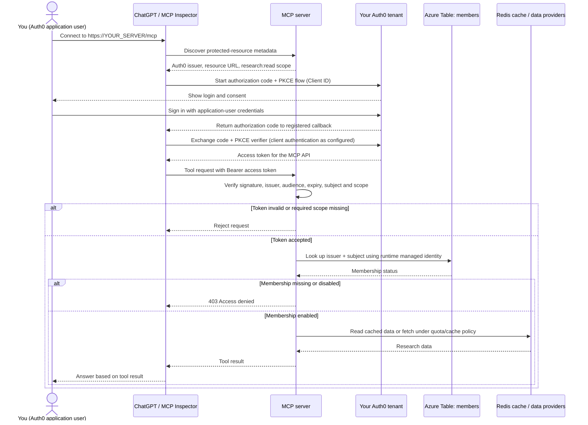

# Authentication and access: who is who?

There are two separate permission systems:

- **Auth0 + the membership table** decide who may use MCP tools.
- **Azure IAM** decides who may deploy the server and access storage or secrets.

You can be the administrator and an MCP user, but those are different identities.
Using the same email address does not automatically connect their permissions.

## 1. Accounts and resources

```mermaid
flowchart TB
    owner["You, acting as administrator"]

    subgraph auth0["Auth0 tenant"]
        dashboard["Auth0 dashboard account<br/>Creates and manages the tenant's resources"]
        application["Application: OAuth client<br/>ChatGPT or MCP Inspector<br/>Client ID, Client Secret, callback URLs"]
        api["API: protected MCP resource<br/>Identifier: https://YOUR_SERVER/mcp<br/>Permission: research:read"]
        user["Application user<br/>User ID: auth0&#124;123...<br/>Email/password or social login"]
        dashboard -->|configures| application
        dashboard -->|registers| api
        dashboard -->|manages| user
    end

    subgraph azure["Azure subscription"]
        operator["Azure operator identity<br/>Local CLI normally uses az login"]
        server["Container App<br/>Runs the MCP server"]
        identity["Runtime managed identity<br/>Separate from your personal Azure account"]
        members["Table Storage: members<br/>Enabled/disabled memberships"]
        backups["Blob Storage: access-backups<br/>Membership backup files"]
        vault["Key Vault<br/>Finviz API key, Redis URL, cursor secret"]
        operator -->|"Owner: deploy resources and assign roles"| server
        operator -->|"Storage Table Data Contributor"| members
        operator -->|"Storage Blob Data Contributor"| backups
        operator -->|"Key Vault Secrets Officer"| vault
        server -->|runs with| identity
        identity -->|"Storage Table Data Reader"| members
        identity -->|"Key Vault Secrets User"| vault
    end

    owner --> dashboard
    owner --> operator
    api -.->|represents, does not host| server
    user -.->|"issuer + user ID identify a membership"| members
```



The Auth0 **dashboard account** is not automatically an Auth0 **application user**.
The Auth0 API registration describes your server; it does not deploy or run it.
Azure **Owner** manages resources and role assignments but does not automatically
grant table/blob data access or secret access. The runtime identity intentionally
cannot grant memberships or manage their backups.

## 2. Signing in and calling a tool



The user's password goes to Auth0, not the MCP server. The MCP server receives an
access token and validates it; it does not need the OAuth client's secret.
Auth0 login alone is insufficient: membership must be enabled too, even for cached
results. If the membership store is unavailable, the server fails closed.

## 3. What the grant command does

```mermaid
sequenceDiagram
    actor Operator as You (Azure operator)
    participant CLI as fv-data-mcp CLI
    participant Entra as Microsoft Entra ID
    participant Table as Azure Table: members
    participant MCP as Deployed MCP server

    Operator->>CLI: grant --subject 'auth0|123...'
    CLI->>CLI: Read configured Auth0 issuer and Table endpoint
    CLI->>Entra: Obtain storage token using DefaultAzureCredential
    Entra-->>CLI: Token for the Azure operator identity
    CLI->>Table: Write issuer + subject with enabled=true
    Table->>Table: Require operator's Storage Table Data Contributor role
    Table-->>CLI: Write successful
    CLI-->>Operator: Grant successful
    Note over CLI,Table: No Auth0 user is created; the subject must identify an existing user
    MCP->>Table: Check membership on the user's next authenticated request
    Table-->>MCP: Enabled
```

Run `az login` as the Azure operator before local administration. The CLI uses
`DefaultAzureCredential`, so another configured credential can take precedence over
the Azure CLI login. The Auth0 subject is the **recipient** of access, not the Azure
identity authorizing the write. Grant does not require a server rebuild or restart.

## Which value goes where?

| Value | Where it comes from | Where it belongs |
| --- | --- | --- |
| OAuth Client ID | Auth0 Application settings | ChatGPT / Inspector OAuth configuration |
| OAuth Client Secret | Auth0 Application settings | OAuth client's secret field, when required; never a user password |
| User ID, e.g. `auth0\|123...` | Auth0 User Management → Users | `grant --subject` / `suspend --subject` |
| User password or social login | Auth0 application user's login method | Auth0 login page only |
| Issuer, e.g. `https://YOUR-TENANT.eu.auth0.com/` | Auth0 tenant domain | `FV_AUTH0_ISSUER` locally; `auth0Issuer` deployment parameter |
| API Identifier / audience | Auth0 API settings | Must equal the deployed HTTPS origin plus `/mcp`, without a slash after `mcp` |
| Azure operator credentials | Azure CLI login or another configured Azure credential | Infrastructure, secret uploads, grants, suspensions and backups |
| Runtime managed identity | Provisioned by `infra/foundation.bicep` | Server access to Azure resources; no personal password |

The application normalizes a missing trailing slash on the **configured issuer**.
This does not change the API identifier: issuer and audience are different values.
Never paste passwords, client secrets or access tokens into documentation or chat.

For setup commands, see [Deployment](deployment.md). For grants, suspensions and
backups, see [Operations](operations.md#access-lifecycle).
